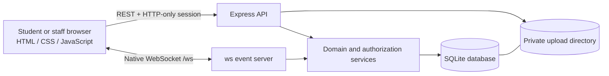
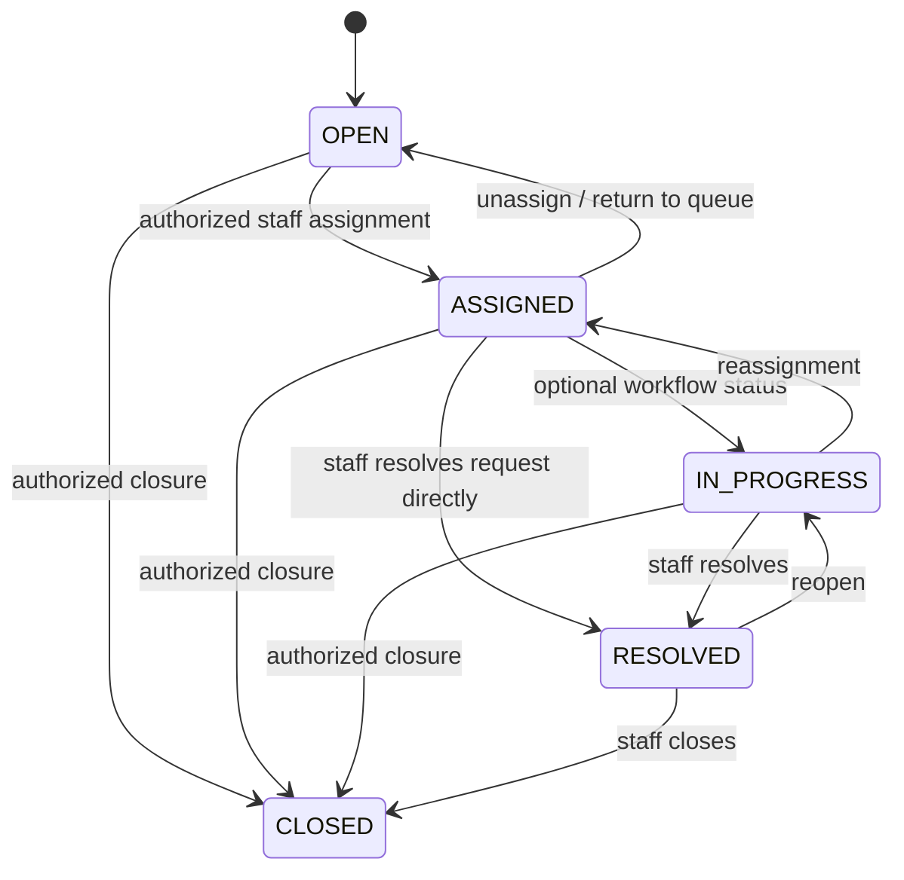

# LYNK architecture and protocol

## Architecture

The existing visual application remains in `index.html`, `styles.css`, and `app.js`. Express serves only those three front-end files; server code, SQLite, environment files, and uploads are not exposed as static paths. REST uses relative `/api` URLs. The browser derives its WebSocket URL from the current origin (`ws:` or `wss:`); the server port and origins are environment-configured.

The application currently runs as a single Node process. SQLite is accessed through Node 24's built-in `node:sqlite` synchronous API. This is a small-deployment starting point, not a horizontally scaled database or multi-process presence service.

## Database model

The schema is initialized idempotently in `server/db.js` and includes foreign keys and indexes.

| Table | Purpose and constraints |
|---|---|
| `users` | Unique email, bcrypt hash, role, last-seen time, notification preferences |
| `sessions` | Revocable server-side session records backing signed HTTP-only cookies |
| `tickets` | Unique public ticket ID; student, optional assignee, title, details, category, priority, status, dates |
| `conversations` | Unique `ticket_id`: one conversation per ticket |
| `conversation_participants` | Authorized conversation participants; ticket authorization is rechecked for every operation |
| `messages` | Unique client `messageId`, ticket and conversation IDs, sender, receiver, status, per-conversation sequence, retries, timestamps |
| `message_acknowledgements` | Idempotent ACCEPTED, DELIVERY_ACK, READ_ACK, RETRY, FAILED audit events |
| `attachments` | Original and generated stored names, MIME, byte size, SHA-256, parent ticket/message |
| `notifications` | Persisted per-user notification type, content, ticket relation, read state and date |
| `ticket_history` | Actor-attributed ticket creation, assignment, status, and priority changes |

IDs are UUIDs except user-facing ticket IDs. Messages use a database uniqueness constraint on `(conversation_id, sequence_number)` and a global unique client message ID. Foreign keys are enabled on connection. The service/repository boundary is currently the `domain.js` data/service layer plus parameterized queries in routes; database-specific SQL is SQLite and would need to move behind a formal repository interface before switching engines.

## REST API

All API paths are under `/api`. JSON errors use `{ "error": { "code", "message" } }` and avoid returning internal exceptions.

| Method | Route | Access |
|---|---|---|
| `POST` | `/auth/register` | Public; creates STUDENT only |
| `POST` | `/auth/login` | Public, rate limited |
| `POST` | `/auth/logout` | Revokes current session and closes that user's sockets |
| `GET` | `/auth/me`, `/users/me` | Authenticated |
| `PATCH` | `/users/me` | Authenticated; name or password change |
| `GET/PATCH` | `/users/me/preferences` | Authenticated |
| `GET` | `/dashboard` | Authenticated; counts are database-derived |
| `GET/POST` | `/tickets` | Any authorized role / STUDENT create |
| `GET/PATCH` | `/tickets/:id` | Ticket authorization; staff mutation |
| `GET` | `/tickets/:id/conversation` | Ticket authorization and participant policy |
| `GET` | `/conversations/:id/messages` | Ticket and conversation authorization |
| `GET` | `/tickets/:id/history` | Ticket authorization |
| `GET/PATCH` | `/notifications`, `/notifications/:id/read`, `/notifications/read-all` | Authenticated; own records only |
| `GET` | `/admin/users` | ADMIN or HELPDESK; lists staff accounts |
| `POST` | `/admin/users` | ADMIN only; creates an ADMIN or HELPDESK account with a bcrypt-hashed password |
| `POST` | `/tickets/:id/attachments` | Authorized ticket participant; multipart `file`, optional `caption` |
| `GET/POST` | `/attachments/:id`, `/attachments/:id/verify` | Ticket authorization; SHA-256 verification |

Ticket list search covers public ID, title, category, priority, status, student, and assigned support user. Status and priority/category filters are applied to server results.

## Authorization rules

- A student can select only a ticket with their own `student_id`.
- An ADMIN can administer tickets across the queue.
- A HELPDESK user can access an unassigned ticket in the queue and tickets assigned to their own user ID. A reassigned former user loses conversation access even if an old participant row remains.
- The conversation ID must resolve to the requested ticket's unique conversation. Message sender identity is taken from the authenticated cookie and a supplied `senderId` must match.
- The receiver is computed server-side from the ticket and role. Client-supplied receiver data cannot route a message to an arbitrary account.
- Attachment download and hash verification repeat the parent ticket authorization check.

## Ticket lifecycle

Transitions are checked in `PATCH /api/tickets/:id`. Assignment and status updates are recorded in history, notifications are persisted, and ticket events are emitted to connected subscribers.

## WebSocket connection and presence

The browser connects to `/ws` using its HTTP-only session cookie. Unauthenticated upgrades are rejected. Clients send `SUBSCRIBE` for a ticket/conversation; the server checks access, returns a `SYNC_RESPONSE`, and emits the other participant's current `ONLINE` or `OFFLINE` state. The server sends WebSocket ping frames at `HEARTBEAT_INTERVAL_MS`; clients are removed from online presence after a missed pong/closed connection. Presence is process memory, while `last_seen` is persisted. On a multi-process deployment, presence requires a shared broker/store.

The client reconnects with bounded exponential backoff, requests synchronization, re-subscribes its active conversation, and retries any message that was pending client-side with the same message ID. Pending client messages have not yet been accepted by the server; the authoritative offline queue is persisted server-side once a recipient is offline.

## Application-level ACK protocol

```mermaid
stateDiagram-v2
  [*] --> PENDING: client composes / sends
  PENDING --> SENT: server authenticates, authorizes, persists, MESSAGE_ACCEPTED
  PENDING --> QUEUED: recipient offline; persisted for delivery
  SENT --> DELIVERED: recipient application sends DELIVERY_ACK
  DELIVERED --> READ: recipient opens conversation and sends READ_ACK
  SENT --> SENT: ACK timeout, MESSAGE_RETRY, retry_count incremented
  SENT --> FAILED: MAX_RETRIES exceeded
  QUEUED --> SENT: recipient reconnects and server emits queued message
```

The server does not mark a message delivered when it is merely stored or written to a socket. The recipient emits `DELIVERY_ACK` after its application receives the event. `READ_ACK` is emitted only for messages in the visible, selected conversation. Messages are ordered by server-assigned sequence number. Repeated `MESSAGE` events with the same client ID return the original accepted record and never insert a second message.

### Event envelope

Events carry a `type`, server timestamp, and the relevant user, ticket, conversation, and message identifiers. `MESSAGE` contains the persisted message DTO including sender, receiver, content, status, sequence, and timestamps. The server computes sender from the session and validates all related IDs.

Implemented event names include `CONNECTION_INIT`, `SUBSCRIBE`, `PRESENCE_UPDATE`, `MESSAGE`, `MESSAGE_ACCEPTED`, `DELIVERY_ACK`, `MESSAGE_DELIVERED`, `DELIVERY_ACK_ACCEPTED`, `READ_ACK`, `MESSAGE_READ`, `READ_ACK_ACCEPTED`, `MESSAGE_RETRY`, `MESSAGE_FAILED`, `SYNC_REQUEST`, `SYNC_RESPONSE`, `ATTACHMENT_MESSAGE`, `TYPING_START`, `TYPING_STOP`, `NOTIFICATION`, `TICKET_CREATED`, `TICKET_UPDATED`, `TICKET_STATUS_CHANGED`, and `ERROR`.

### Offline and retry behavior

If a recipient has no active connection, the message is persisted as `QUEUED`. On `SYNC_REQUEST` or subscription after reconnect, queued rows are selected by conversation and sequence and sent in order. On application receipt, the client acknowledges delivery; opening that ticket acknowledges read. A connected but unresponsive recipient triggers retry events after `ACK_TIMEOUT_MS`; after `MAX_RETRIES`, the record becomes `FAILED`. Repeated incoming IDs are merged by the browser and deduplicated by SQLite on the server.

## Attachments and integrity

Current allowlist: PDF, PNG, JPEG, WEBP, and plain text. Multer checks size, extension, and MIME, then the server verifies file signatures/content before persisting. Disk names are generated UUIDs in the private upload directory; user filenames are retained only as sanitized metadata. The server computes SHA-256 after upload and stores it with size and MIME. Authenticated download rehashes the file before sending it. The verify route reports `VERIFIED` or `FAILED` and includes expected/actual hashes for diagnostic comparison.

## Notifications and preferences

Ticket creation, assignment, status changes, new messages, and attachments create database notifications subject to the recipient's saved notification preferences. `GET /api/notifications` is scoped to the authenticated user. Read state persists through PATCH routes. The reduced-motion setting remains browser-local because it is a display preference, not account data.

## Tests and load exercise

`npm test` executes `tests/system.test.js` against an in-memory SQLite database and ephemeral HTTP/WebSocket server. It exercises session revocation, student ownership, helpdesk scope, ticket transitions, conversations, live messages, duplicate protection, DELIVERY_ACK/READ_ACK, offline queue ordering, retries, attachment validation/download, SHA-256, notifications, and ticket isolation.

`npm run load` invokes `tests/load-test.js`. Set `NUMBER_OF_CLIENTS`, `NUMBER_OF_TICKETS`, `MESSAGES_PER_CLIENT`, `MESSAGE_INTERVAL`, `BASE_URL`, `ADMIN_EMAIL`, and `ADMIN_PASSWORD`. It reports observed connections, message delivery, ACKs, retries, errors, reconnect outcomes, latency, and throughput. Results depend on the machine and should be measured on the deployment target.

## Deployment limits

The API, persistence, access control, WebSocket ACK flow, offline queue, and attachment integrity are implemented for a single-process deployment. Before exposing it publicly, configure production secrets, HTTPS and `COOKIE_SECURE`, a trusted `CLIENT_URL`, backup and restore for SQLite and uploads, log retention, a reverse proxy that supports WebSocket upgrades, and an operational process manager. A horizontally scaled service needs a shared database with a production migration strategy and a shared presence/event broker. No performance results are asserted here.
